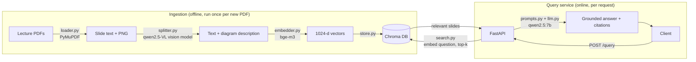

# Lecture Slides RAG

Ask a question about a university lecture course and get an answer **grounded in the lecture slides, with the slide it came from cited**. If the slides don't cover the question, the service says so instead of guessing.

Everything runs locally: three open-weight models are served by [Ollama](https://ollama.com), retrieval uses a [Chroma](https://www.trychroma.com) vector database, and the system is exposed as a [FastAPI](https://fastapi.tiangolo.com) inference service, packaged with Docker Compose.

```bash
curl -X POST http://localhost:8000/query \
  -H "Content-Type: application/json" \
  -d '{"question": "How long is the final exam?"}'
```
```json
{
  "answer": "The final exam will be 3 hours in length, with an additional 15 minutes for reading time (01_Introduction.pdf, slide 22).",
  "sources": [
    {"pdf_name": "01_Introduction.pdf", "slide_num": 22},
    {"pdf_name": "01_Introduction.pdf", "slide_num": 14},
    {"pdf_name": "01_Introduction.pdf", "slide_num": 16},
    {"pdf_name": "05_Estimation_Procedures.pdf", "slide_num": 54}
  ],
  "timings_ms": {"retrieval": "2265", "generation": "13909"}
}
```

---

## Why this project

I built this to learn how retrieval-augmented generation (RAG) works end to end, and to practise taking ML models from a notebook-style script to a deployable, monitorable service: model serving, an API contract other code can integrate with, health checks, containerisation, and an evaluation harness that measures whether the system is actually good enough.

## Architecture

The system has two halves: an **offline ingestion pipeline** that turns PDFs into a searchable index, and an **online query service** that answers questions against it.



| Stage | File | What it does |
|---|---|---|
| Load | `src/ingestion/loader.py` | Extracts each slide's text and renders it to PNG with PyMuPDF. |
| Describe | `src/ingestion/splitter.py` | A vision-language model (`qwen2.5vl:7b`) looks at each slide image and describes any chart, diagram, table or formula. One slide = one chunk. |
| Embed | `src/ingestion/embedder.py` | Embeds each chunk with `bge-m3` (1024 dimensions). |
| Store | `src/ingestion/store.py` | Upserts vectors, text and metadata into a persistent Chroma collection. Idempotent: re-running never duplicates. |
| Retrieve | `src/retrieval/search.py` | Embeds the question with the same model and returns the top-k nearest slides. |
| Generate | `src/generation/prompts.py`, `llm.py` | Builds a prompt with the slides labelled by source and asks `qwen2.5:7b` to answer **only** from them, citing slides. |
| Orchestrate | `src/rag.py` | `answer(question)` runs retrieval then generation and records per-stage latency. |
| Serve | `src/api.py` | FastAPI service: `POST /query`, `GET /health`, auto-generated docs at `/docs`. |

The serving path (`api.py`, `rag.py`, `retrieval/`, `generation/`, `config.py`) is about 160 lines of Python.

## Quickstart

**Requirements:** [Docker Desktop](https://www.docker.com/products/docker-desktop/). Allocate at least 8 GB of memory to Docker for the 7B model.

```bash
git clone https://github.com/WH-Ng/rag.git
cd rag

# Start the API and Ollama containers
docker compose up -d --build

# Download the models used at query time into the Ollama container
docker compose exec ollama ollama pull bge-m3
docker compose exec ollama ollama pull qwen2.5:7b

# Check the service is healthy
curl http://localhost:8000/health
```

Then open **http://localhost:8000/docs** to try queries interactively.

> **Note:** To use your own documents, build the index first — see [Ingesting documents](#ingesting-documents).

## API

| Method | Endpoint | Description |
|---|---|---|
| `POST` | `/query` | Ask a question. Body: `{"question": str (1–1000 chars), "top_k": int (1–20, default 4)}` |
| `GET` | `/health` | Returns `200` with the number of indexed chunks when the vector store is reachable and the query-time models are available; `503` if a model is missing. Used by the Docker health check. |
| `GET` | `/docs` | Interactive OpenAPI documentation. |

Request and response bodies are validated with Pydantic, so malformed requests (empty question, `top_k` out of range) are rejected with `422` before any model runs. The response model also strips internal fields such as local file paths.

**Calling the service from Python** — no knowledge of the internals needed:

```python
import requests

r = requests.post("http://localhost:8000/query",
                  json={"question": "What are the approaches of point estimation?"})
data = r.json()
print(data["answer"])
for s in data["sources"]:
    print(f"  - {s['pdf_name']} slide {s['slide_num']}")
```

## Ingesting documents

Ingestion runs locally (outside Docker) because it is a one-off batch job and uses the vision model, which the query service does not need.

```bash
pip install -r requirements.txt
ollama pull qwen2.5vl:7b && ollama pull bge-m3

# put PDFs in data/raw/lectures/, then from src/:
cd src
python -m ingestion.loader      # PDF -> per-lecture *_slides.json + slide images
python -m ingestion.splitter    # vision descriptions -> per-lecture *_chunks.json   (slowest step)
python -m ingestion.embedder    # all chunks -> embedded_chunks.json
python -m ingestion.store       # upsert into storage/chroma_db
```

The pipeline writes **one file per lecture** and skips lectures already processed, so it is resumable: if the slow vision step fails part-way through, re-running continues from where it stopped. The Chroma DB in `storage/` is mounted into the API container, so new documents are picked up on restart without rebuilding the image.

## Evaluation

`eval/evaluate.py` sends a fixed set of questions with known answer slides to the **running API** (testing the deployed system, not just the Python functions) and reports:

| Metric | Meaning |
|---|---|
| **Hit rate@4** | Share of in-scope questions where a correct slide was among the 4 retrieved. |
| **MRR** | Mean reciprocal rank of the first correct slide (1st = 1.0, 2nd = 0.5, …). |
| **Answer rate** | Share of in-scope questions that got an answer rather than a refusal. |
| **Refusal rate** | Share of out-of-scope questions (e.g. *"What is the capital of France?"*) where the model correctly said it couldn't find the answer. |
| **Latency** | Median and max end-to-end response time. |

The test set (`eval/questions.json`) has 12 questions: 10 in scope across two lectures (including diagram-only slides, a table and an R-code question) and 2 out of scope.

### Results

| Run | Indexed | Questions (in / out of scope) | Hit rate@4 | MRR | Answer rate | Refusal rate | Median latency | Max latency |
|---|---|---|---|---|---|---|---|---|
| v1 | Lecture 01 | 6 (4 / 2) | 0.75 | 0.63 | 0.75 | 1.00 | 10.2 s | 17.6 s |
| v2 | Lectures 01 + 05 | 12 (10 / 2) | 0.90 | 0.73 | 0.80 | 1.00 | 7.0 s | 12.6 s |

Latency was measured on an M4 Macbook Pro (16 GB) with Ollama running natively. Full per-question results are in `eval/results*.json`. Between v1 and v2 the question set was also cleaned up (a duplicate removed, a typo fixed, extra acceptable slides added), so the two runs are indicative rather than strictly like-for-like.

### What the evaluation revealed

- **It fails safely.** Both out-of-scope questions were refused in every run, and when retrieval missed, the model replied *"I couldn't find that in the lecture slides"* instead of inventing an answer.
- **Retrieval success does not equal a useful answer.** For *"What was the histogram generated from a Uniform Distribution?"* the correct slide was retrieved first, yet the model still refused. The histogram exists only as an image, and the vision model's description wasn't detailed enough for the LLM to answer confidently. Hit rate alone would have marked this as a success, which is why the evaluation also tracks answer rate.
- **Code-heavy slides retrieve poorly.** The R-function question failed even with "Newton-Raphson" spelled out (ruling out the abbreviation as the cause). The target slide is mostly R code, which embeds poorly against a natural-language question. The neighbouring Newton-Raphson slides ranked higher.
- **Latency is dominated by generation and grows with answer length.** The slowest responses were the longest answers (e.g. a probability table with formulas).

Answer *correctness* is not scored automatically; answers were spot-checked manually against the slides.

## Design decisions

- **One slide = one chunk.** Lecture slides are already small, self-contained units, so they make natural retrieval units, and citations map directly to a slide number a student can look up.
- **Vision model at ingestion time.** Many slides are mostly charts or diagrams, where extracted text is nearly empty. Describing each slide image once during ingestion makes visual content searchable without running a vision model per query.
- **Prompt with an explicit refusal.** The system prompt restricts the model to the retrieved slides and tells it to refuse otherwise. For a question-answering service, a clear "I don't know" is safer than a confident hallucination.
- **Deterministic generation.** `temperature=0` makes the same question give the same answer, which makes evaluation reproducible. `num_ctx=8192` prevents Ollama from silently truncating long prompts.
- **Local, open-weight models.** No data leaves the machine, and there are no API costs.
- **Configuration in one place.** Paths, model names and the collection name live in `src/config.py`; the DB path and Ollama host can be overridden with environment variables, which is how the same code runs on the host and in Docker.
- **Pinned vector-store version.** `chromadb` is pinned so the container can always read an index built on the host.

## Limitations and next steps

- **Image-only slides:** answer quality depends on the vision description. A richer prompt for charts, or passing the slide image to a multimodal model at query time, would help.
- **Code and abbreviations:** pure vector search struggles with code-heavy slides and exact terms. Hybrid search (vector + BM25 keyword) or a re-ranker is the natural next step.
- **Observability:** per-stage timings are returned in each response, but not yet logged or exported as metrics.
- **Coverage:** only 2 of the 15 lectures are currently indexed
- **Evaluation size:** 12 questions is too small of a sample size to conduct statistical testing and inference.

## Project structure

```
.
├── Dockerfile               
├── docker-compose.yml       
├── requirements.txt
├── eval/
│   ├── evaluate.py          
│   ├── questions.json      
│   └── results*.json        
└── src/
    ├── config.py            
    ├── api.py               
    ├── rag.py              
    ├── ingestion/           # loader, splitter, embedder, store
    ├── retrieval/search.py
    └── generation/          # prompts.py, llm.py
```

## Tech stack

Python · FastAPI · Pydantic · Uvicorn · Ollama (`qwen2.5:7b`, `qwen2.5vl:7b`, `bge-m3`) · ChromaDB · PyMuPDF · Docker Compose
